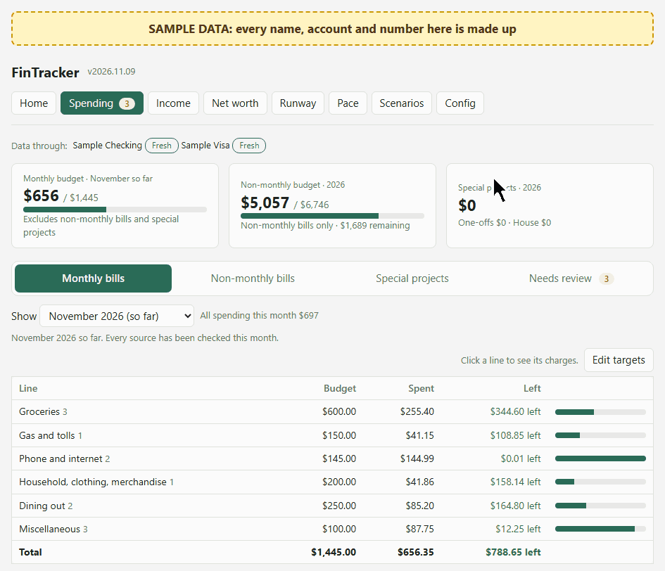
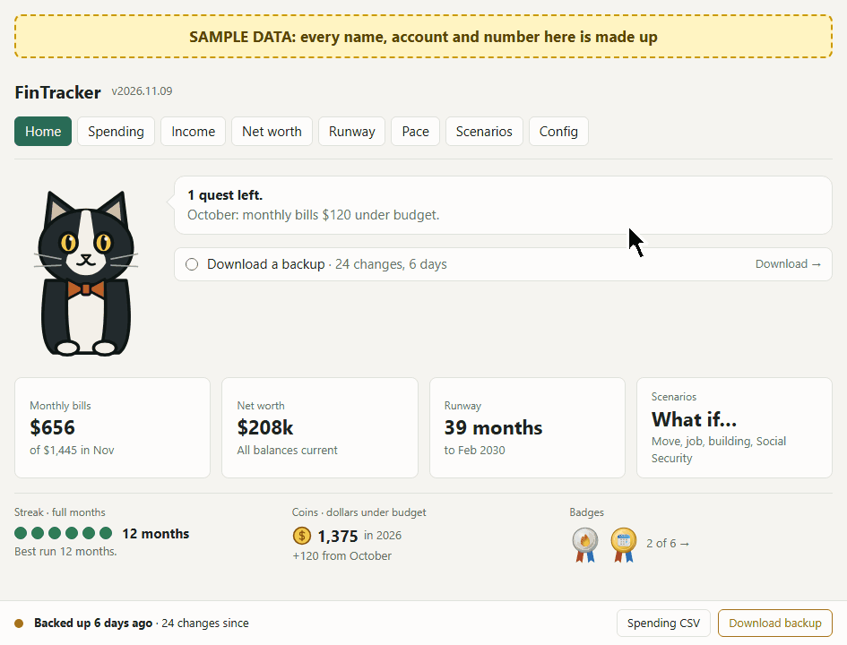
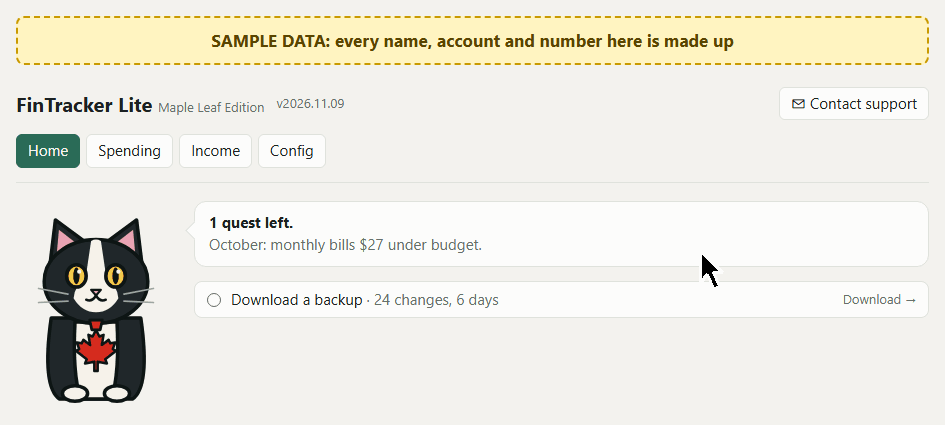
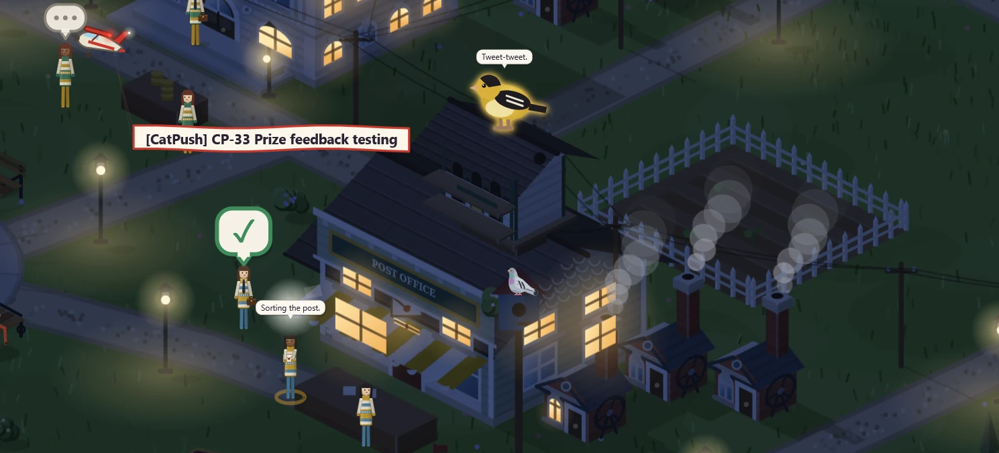

# Jenny Reid

**Technical product manager · Localization & internationalization SME**

Previously at BlackBerry, Guidewire and RingCentral.

- At RingCentral, I launched AI-driven localization workflows in January 2025 that cut per-word costs by 35%, then brought it all in-house. I presented the approach at LocWorld, Monterey, in October 2025.
- Currently experimenting with AI, working with it the way I've worked with engineering teams. Interested to compare notes with others experimenting in their own ways.

## How I work

- **I'm the product owner.** I track tickets on a Kanban board, prioritize the work, and test every change before it ships.
- **Claude is the product manager.** One PM per project, and each PM is a persona that persists: when a PM's conversation fills up, it writes a handoff, starts its successor and archives itself. PMs write the tickets and prompts, and I review them.
- **Codex is the engineer** (sometimes Claude). One conversation per ticket keeps the context focused. Unlike the PMs, engineers don't need to persist: the ticket and the engineer's report hold what matters, so each conversation is archived when its ticket is done, and so far I haven't missed anything.
- **Rules stay lean.** If I bring something to the wrong PM, it points me to the right one instead of going off on a tangent. Too many rules bloat the context and make the team rigid, so I keep the shared rules short.
- **Each tool does what it's best at.** The PM says what's needed, and the engineer decides how.

**Toolkit:** Claude Code · Codex · OpenClaw · OpenAI · Runway · Discord · GitHub · JavaScript · Python · Android

## Projects

**FinTracker**: a personal finance app for Windows and Android, and my most finished product. It imports transactions automatically and tracks bills against budget, net worth, runway and what-if scenarios. The code is private, so screenshots use sample data.

**FinTracker Lite**: a budgeting-only Maple Leaf Edition built from the same code, with personal data kept separate.

**[Cat Coin Pusher](https://github.com/jennylreid/cat-coin-pusher)**: a long-term game project. The repo shows the process at work: tickets, engineer reports and test builds before each release.

 
 

**Finch**: an OpenClaw agent on my team. She pings me on Discord when work needs me, and in the car she's a hands-free voice for brainstorming. She sends her notes to my PMs.

**Agent dashboard**: status for every agent at a glance. Each project is a building, and each agent is a worker. A raised hand means they need me, a flare means something is urgent, a plane with a banner means work is ready to test, and ships at sea are the backlog. It also has a free, local voice chat.

**Cat TikTok**: short AI-made videos, like a tuxedo cat on a country drive who meets a deer.

**Escape Room**: my first AI-built game, a point-and-click adventure made in RingCentral's AI experimentation program. It's where this process started. RingCentral owns it, so it isn't shared.

## How I measure it

**October 2026:** 104 tickets and 189 commits across 8 projects. That's about 2 hours of agent work for every hour of mine, for about $168 in AI tools.

- **Monthly stats** per project: time, tickets, commits, cost and reply times.
- **Capacity page**, refreshed every morning: usage and spend across every AI service, with likely-unused credit flagged so it gets used first.

📫 [LinkedIn](https://www.linkedin.com/in/jennyreid/), open to full-time roles in product management, localization and AI.
