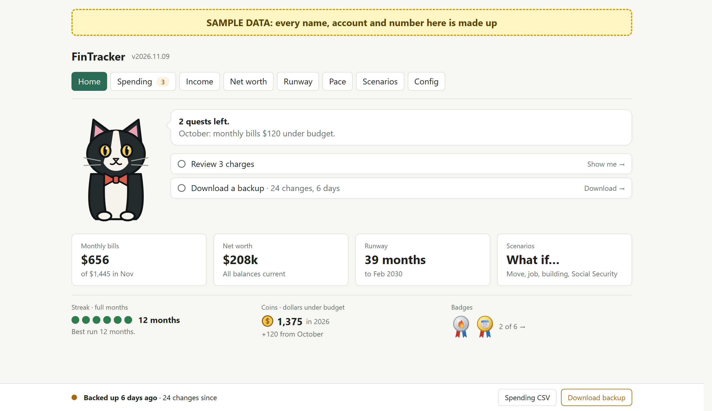
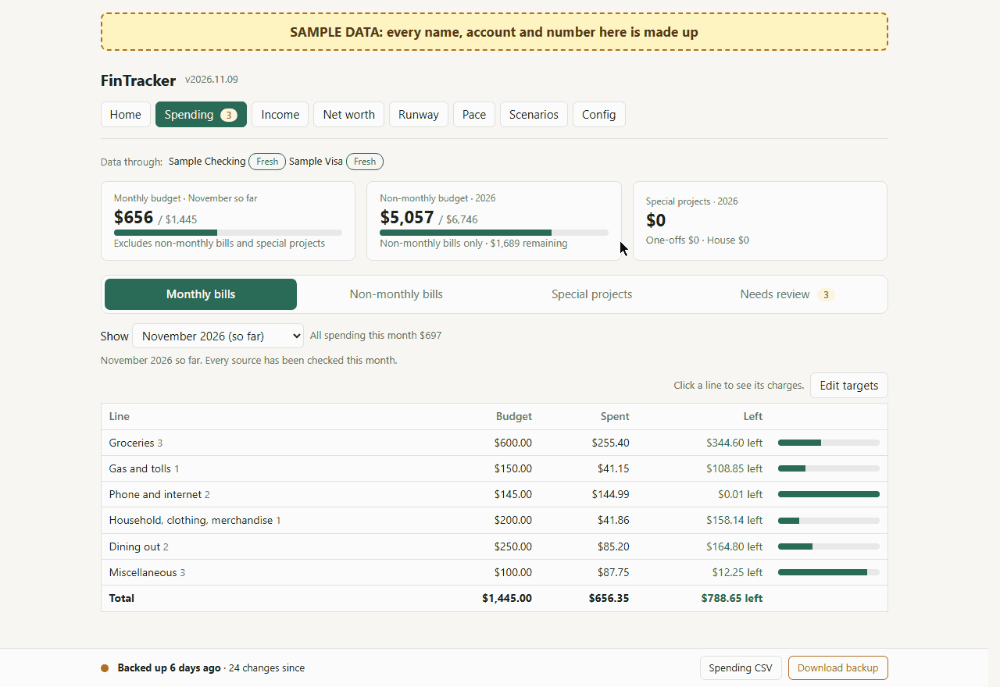
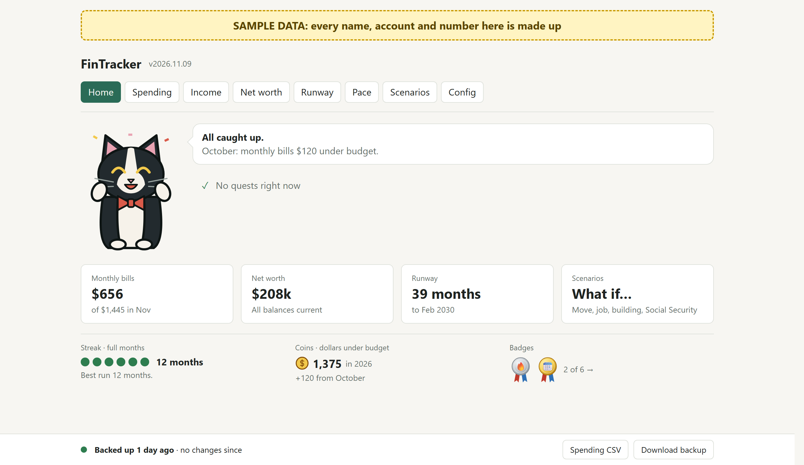
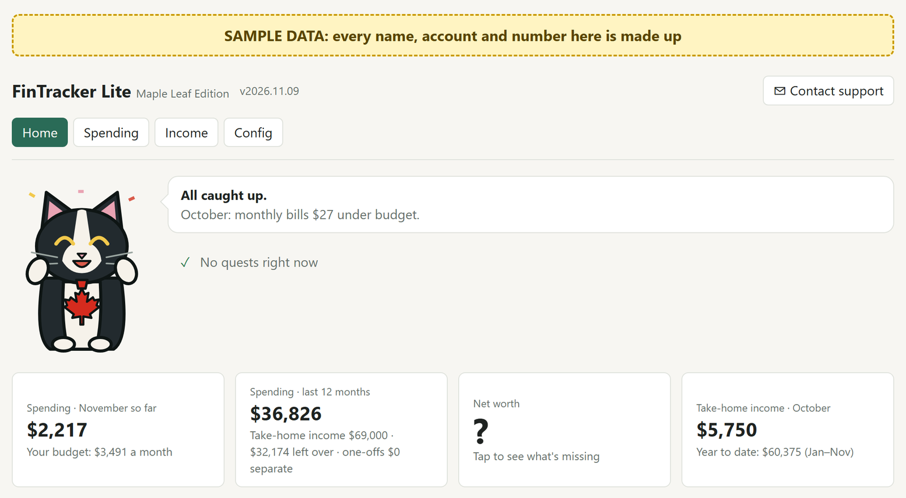
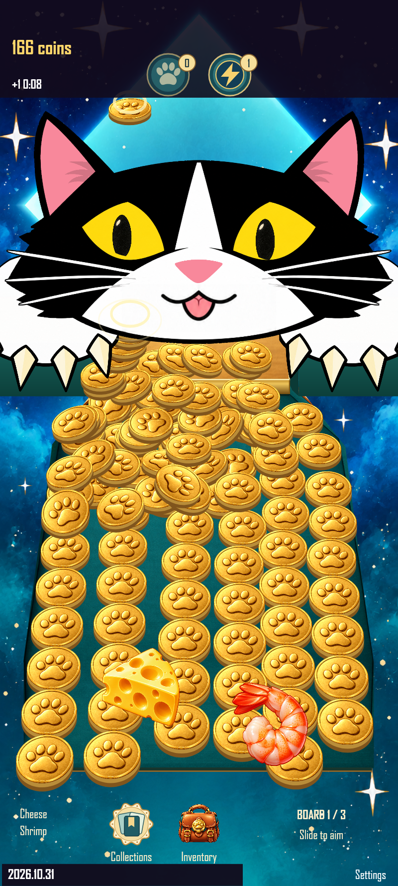
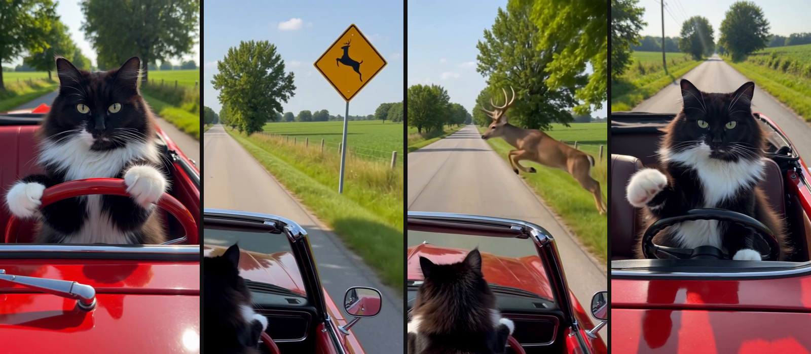
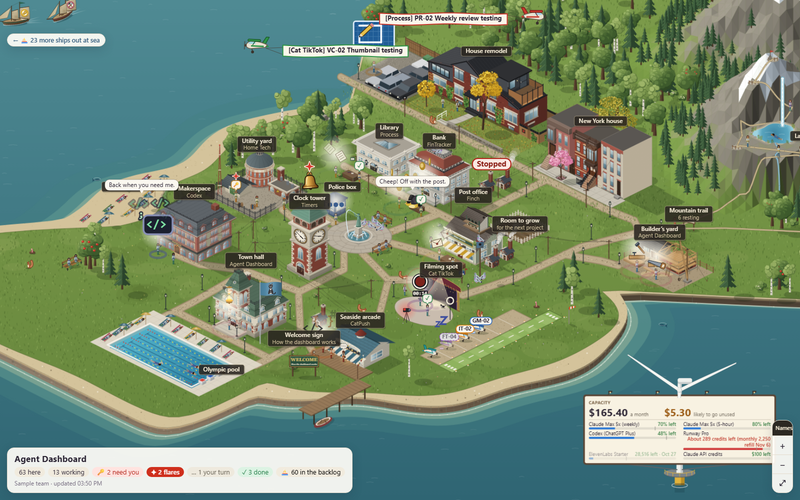
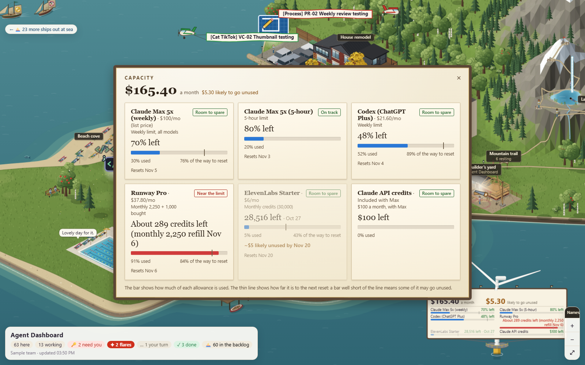
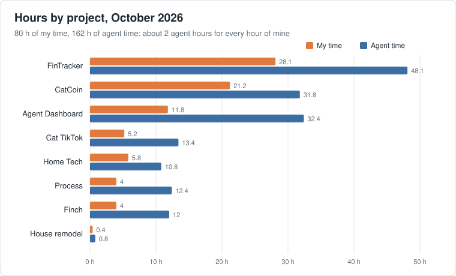

# Hi, I'm Jenny Reid

I'm a localization and internationalization SME who builds with AI. As a technical product manager, I've worked with engineering teams at BlackBerry, Guidewire and RingCentral. At RingCentral, I implemented AI-driven localization workflows that went live in January 2025 and cut per-word costs by 35%. We later brought it all in-house, replacing our TMS and our external AI localization vendor. In October 2025, I presented our approach at LocWorld in Monterey, California.

In summer 2026, I started experimenting with AI beyond localization: I built my first game during RingCentral's AI experimentation program, and since leaving RingCentral, I've been building my own apps full time with a 100% AI team.

## How I work: an AI team run like an engineering team

I run my AI team the way I've always worked with engineering teams.

- **I'm the product owner.** I decide what we build, set priorities on a Kanban board, and test every change before it ships.
- **Claude is the product manager.** I have a PM per project, plus one for process. I tell a PM what I need, it writes the ticket and the prompt, and I review the prompt before it goes to an engineer.
- **Codex is the engineer** (sometimes Claude, depending on the work). Every ticket gets its own conversation, named after the ticket.

Every team member understands their role and always assigns or passes work to the correct role.

My team's toolkit: Claude Code · Codex · OpenClaw · OpenAI · Runway · Discord · GitHub · JavaScript · Python · Android

## What I've learned

**Keep context clean.** Each conversation can only hold so much, so I keep each one focused. With human PMs, you can see who you're talking to. With a sidebar full of chats, it's easy to enter ideas, prompts or text into the wrong window. I realized early on that this would be a common human error, so I created a rule for the team: if I bring something to the wrong PM, it just sends me to the right one instead of going off on a tangent or even trying to discuss the error with me.

**Don't overmix.** The PMs keep a shared file of rules for how we work. Too many rules, or rules that are too rigid, backfire: they bloat the context and make the team brittle. It's like baking: overwork the dough and it turns tough. So I prune the rules regularly and keep them lean.

**Let each tool do what it's best at.** I don't let Claude PMs micromanage Codex engineers. They have different strengths. For example, I had far greater success creating artwork with Codex than with Claude. So the Claude PM describes what's needed, and the Codex engineer decides how to build it.

**Automate, but stay in the loop.** I step in only where a human adds value, and I make sure I understand everything the team is doing. AI will sometimes try to do things I didn't ask for or don't agree with. When that happens, I make rules :)

## Projects

As part of RingCentral's AI experimentation program, PMs were each asked to build a game with AI. Mine was **Escape Room**, a point-and-click adventure inspired by my favorite PC game as a kid, King's Quest VI. I enjoyed it and worked nights and weekends to complete it. After 40 hours, it was small but essentially fully baked. That's where I started developing my process, with Claude as PM and Codex as engineer. The game belongs to RingCentral, so I can't share it.

**FinTracker** was the first thing I built after leaving RingCentral, and it's my most finished product: a personal finance app for Windows and Android, tailored to my husband's and my needs, with transactions imported automatically, monthly bills against budget, net worth, runway and what-if scenarios. The code isn't public, so the screenshot uses sample data.

From the same code, I also build **FinTracker Lite**, a Maple Leaf Edition for my husband in Canada. All personal data is kept separate from the code. It starts lean, with budgeting only, and I'll add features as he uses it.

**[Cat Coin Pusher](https://github.com/jennylreid/cat-coin-pusher)** is my current game, and a very different challenge. Escape Room delighted through its story, puzzles, cleverness and music. A coin pusher has to delight moment to moment, through how it looks, how smoothly it plays and how it pays off, and getting that right takes far longer. It's a long-term side project, and the repo shows my process at work: tickets, engineer reports, and test builds before each release.

 
 

I also set up an OpenClaw agent named **Finch**, who is another member of my team. Finch can ping me on Discord when an engineer is waiting for approval or a task is done. I gave her a premium, interactive voice, so I can brainstorm with her hands-free in the car (she even hangs up when I ask), and she takes notes and sends them to my PMs for processing. She could do a lot more, but API costs add up, so I keep her role small for now and ready to grow as new uses come along. It's early days, and things are moving quickly.

**Cat TikTok** is a series of short AI-made videos, like this one: a tuxedo cat on a country drive meets a deer-crossing sign, and then a deer.

**Agent dashboard.** With many AI agents working across several projects, it was getting tricky to track status for each text-based conversation/chat. So I built a dashboard that gives me complete status at a glance: each project is a building, and each agent is a worker I can see at their post. When one needs me, they raise a hand; for urgent problems they send up a flare, work that's ready to test is signaled by a plane flying a banner, and the backlog waits as ships out at sea. Since Claude Code doesn't offer interactive voice, I've added my own to the agent dashboard. It's free and runs locally: my Chrome browser's speech recognition listens, and Windows' built-in voices answer. The quality isn't as good as Finch's premium voice, but it's free, and I can upgrade later if it proves worth it. It's in early testing stages now, along with a meeting room for video calls.

## How I measure it

I track my AI team like any engineering team. In October 2026: 104 tickets done and 189 commits across 8 projects, about 2 hours of agent work for every hour of mine, for about $168 in AI tools.

- **Monthly project stats:** time, tickets, commits, cost and reply times per project, from the conversation logs, ticket boards and Git.
- **Capacity page:** refreshed every morning with usage and spend across Claude, Codex, OpenAI and the other services. It flags anything likely to go unused, so I put work there first.

## What's next

I'm looking for a full-time role. Lately I've been building my own projects and going deep on AI. If my mix of skills (product management, localization and internationalization, and building with AI) fits your team, I'd love to talk.

📫 [LinkedIn](https://www.linkedin.com/in/jennyreid/)
